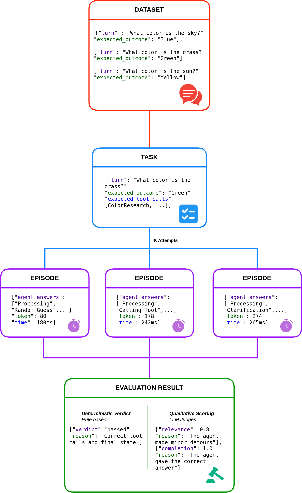

# BAT-CLI User Guide

## Introduction

**BAT-CLI (BubbleRAN Agentic Toolkit CLI)** is a command-line companion to [BAT-ADK](../../adk/docs/bat-adk.md). It gives you a single entry point to **scaffold, configure, containerize, deploy and evaluate** BAT agents, so you can move from an empty directory to a deployed, benchmarked agent without writing boilerplate.

The CLI is distributed on PyPI as `bat-cli` and exposes a single executable: `bat`. Installation and copy-paste examples are in the [README](../README.md); this guide explains what each command does and why. How the code is organised is in [DESIGN.md](DESIGN.md).

BAT-CLI lets you focus on **agent behavior**, not on the lifecycle plumbing around it. It encodes the conventions of a BAT agent project (file layout, environment variables, Docker build, cluster manifests, evaluation harness) into a handful of commands, so every agent looks the same and ships the same way.

## Before You Start

You should be familiar with:

- **BAT-ADK basics** — what an Agent Application, an Agent Card (`agent.json`) and an Agent Configuration (`config.yaml`) are, since the CLI generates and operates on them.
- **The agent project layout** — a BAT agent is a Python project managed with [uv](https://docs.astral.sh/uv/): `agent.json`, `config.yaml`, `pyproject.toml`, a `.env`, and a `src/` package holding the graph and the LLM clients.
- **A2A** — agents expose an A2A server over HTTP. The evaluation talks to your agent only through that endpoint.

## Command Tree at a Glance

```
bat
├── init
│   ├── agent
│   │   ├── <name>
│   │   ├── --clients, -c
│   │   ├── --output-dir, -o
│   │   ├── --force, -f
│   │   ├── --port
│   │   ├── --model
│   │   ├── --model-provider
│   │   ├── --privacy
│   │   ├── --reasoning-effort
│   │   └── --service-tier
│   └── blueprint
│       ├── <name>
│       ├── --output-dir, -o
│       ├── --force, -f
│       └── --model-provider
├── add
│   ├── client
│   │   ├── <clients>
│   │   └── --force, -f
│   └── agent
│       ├── <name>
│       ├── --clients, -c
│       ├── --port
│       ├── --model
│       ├── --model-provider
│       ├── --privacy
│       ├── --reasoning-effort
│       ├── --service-tier
│       └── --force, -f
├── set
│   ├── config
│   │   ├── [AGENT]
│   │   ├── --port
│   │   ├── --model
│   │   ├── --model-provider
│   │   ├── --reasoning-effort
│   │   └── --service-tier
│   └── image
│       ├── --docker-registry
│       └── --repo
├── eval
│   ├── init
│   │   ├── [AGENT]
│   │   └── --force, -f
│   ├── run
│   │   └── [AGENT]
│   ├── show
│   │   └── [AGENT]
│   └── plot
│       ├── --folder, -f
│       └── --filter, -F
├── manifests
│   ├── aifabric
│   │   ├── --output, -o
│   │   ├── --name
│   │   ├── --namespace
│   │   ├── --image-pull-secret
│   │   └── --telemetry-endpoint
│   └── composition-model
│       ├── --output, -o
│       ├── --name
│       ├── --namespace
│       ├── --vendor
│       ├── --docker-registry
│       ├── --repo
│       └── --version
├── build
│   ├── --docker-registry
│   ├── --repo
│   └── --version
├── push
│   ├── --docker-registry
│   ├── --repo
│   └── --version
└── version
```

Each branch is one lifecycle stage: **create** (`init`), **extend** (`add`), **configure** (`set`), **evaluate** (`eval`), **describe for the cluster** (`manifests`), and **containerize/distribute** (`build`, `push`). `bat version` prints the installed version. Help is available at every level (`bat --help`, `bat eval --help`, ...).

## Two Project Shapes: Agent and Blueprint

`bat init agent` scaffolds a **standalone agent**: `config.yaml`, `agent.json` and `pyproject.toml` in one directory, started with `uv run .`. Use it for a single agent.

`bat init blueprint` scaffolds a **blueprint**: one uv project holding several agents. The pyproject, the virtualenv, the PyInstaller spec and the packaging live once at the root; each agent is a package right below it with its own `config.yaml` and `agent.json`. One binary serves them all, and `bat add agent <name>` adds one:

```
my-blueprint/
├── pyproject.toml          # one project: one venv, one uv.lock
├── __main__.py             # shared entrypoint; runs the agent named by argv[1]
├── my-blueprint.spec       # one frozen binary for every agent
├── Dockerfile · docker-compose.yaml · Makefile · .env
├── netops/     agent.json · app.py · config.yaml · src/
└── hermes/     agent.json · app.py · config.yaml · src/
```

There is no manifest and no blueprint-level `config.yaml`. **A blueprint is recognised by its layout**: a folder with `pyproject.toml` and `__main__.py` but no `agent.json`. Its agents are the directories right below it that hold `config.yaml` and `agent.json` and no `pyproject.toml` of their own; a directory that has one (a nested MCP server, say) is a separate project. So `bat add agent` and `bat eval` also work in blueprints the CLI did not create.

**The entrypoint picks the agent from `argv[1]`**, locally, in the compose service's `command`, and in the deployment mode's `args` on a cluster. The process runs from the blueprint root, so the entrypoint points `CONFIG_PATH` at `<agent>/config.yaml`, unless `CONFIG_PATH` is already set (compose, `bat eval`) or a `config.yaml` sits at the root (the operator mounts the rendered one at `/app/config.yaml`):

```bash
uv run . netops    # reads netops/config.yaml
make netops        # the same, with .env loaded
```

An agent's name becomes a Python package, so it must be a valid identifier: `cluster_view` is fine, `cluster-view` is rejected.

### What `bat add agent` keeps in sync

The agent folders on disk are the only registry, so almost nothing has to be told about a new agent:

- **`__main__.py`** never changes. It imports the agent named on the command line, lazily, so one agent's dependencies stay off another's startup path.
- **The PyInstaller spec**, the **`Makefile`** and the **`Dockerfile`** find the agent folders themselves.
- **`docker-compose.yaml`** is the one file `bat add agent` edits: it adds a service for every agent that has none yet (including an agent folder added by hand), all on the same image, each mounting its own `config.yaml` and health-checked on its own port. Other services, and your edits to existing ones, are kept; comments in the file are not.

### Building the image

The image installs from the lockfile (`uv sync --frozen`), so a blueprint needs a committed `uv.lock`; `make build` writes one when there is none. The image carries the binary and each agent's `agent.json`, but no `config.yaml`: that is deployment-specific, mounted by `docker-compose.yaml` and provided by the platform on a cluster. It also sets `LANGGRAPH_STRICT_MSGPACK=true`, so checkpoints only deserialize the types the agent's graph declares; the scaffolds pin a `bat-adk` release that supports this.

## Scaffolding (`init` / `add`)

### Creating an agent

`bat init agent <name>` produces a complete, runnable agent project: `agent.json`, `config.yaml`, `pyproject.toml`, a `Dockerfile` and `Makefile`, a `.env`, and a `src/` package with the **AgentGraph** and the **LLM clients**. The flags fill in the generated files:

- `--clients` generates one **ChatModelClient** per name you give.
- `--port`, `--model` and `--model-provider` go into `config.yaml` (`endpoint.port`, `model.name`, `model.provider`). `--model` defaults to `gpt-6-luna`.
- `--reasoning-effort` and `--service-tier` set `model.reasoning_effort` and `model.service_tier`; without them both stay commented out, so the provider's defaults apply. A reasoning effort is supported by gpt-5 and later.

### Adding clients later

`bat add client <names>` adds **ChatModelClient** scaffolds to an existing agent. Run it from the agent root (it expects `src/llm_clients/`); it refuses to overwrite files unless `--force` is given. This keeps the "one client per LLM role" pattern (`reformulator`, `planner`, `executor`, ...) the same whether clients are created up front or later.

### Telemetry privacy floor

An agent's `telemetry.privacy` in `config.yaml` says how much of its internals may leave the process: `none` (the default) | `content` | `names` | `full`, each level redacting everything the one below it does. See [bat-adk.md](../../adk/docs/bat-adk.md) for what each level covers.

`config.yaml` can be edited wherever the agent runs, so for a packaged agent it is a default, not a guarantee. The **floor** closes that gap: a minimum that `config.yaml` can raise but never lower (the effective level is `max(floor, config.yaml)`). Every scaffolded agent passes it where it builds its application:

```python
AgentApplication(
    AgentGraphType=NetopsAgentGraph,
    AgentStateType=NetopsAgentState,
    telemetry_privacy_floor="content",
)
```

`bat init agent --privacy LEVEL` writes the level into the standalone agent's `__main__.py`, and `bat add agent --privacy LEVEL` into the blueprint agent's `app.py`. Without the flag both write `"none"`, so `config.yaml` alone decides. Inside a blueprint the floor is **per agent**, even though all agents share one binary. Being code, it is frozen into the built binary: neither a mounted `config.yaml` nor an environment variable can lower it.

An unknown level is rejected before any file is created: the ADK would silently fall back to `none`, shipping an agent that exports in the clear exactly when someone meant to lock it down.

The floor also applies under `bat eval`, which is why the eval refuses agents with a floor above `none` (see [Before a run](#before-a-run)).

## Configuration (`set config` / `set image`)

The `set` commands update one file in place and leave everything else alone:

- **`bat set config`** writes an agent's runtime values (`--port`, `--model`, `--model-provider`, `--reasoning-effort`, `--service-tier`) into its `config.yaml`, keeping comments and structure. It acts on the agent you are in, or on the one you name from the blueprint root: `bat set config netops --port 9309`.
- **`bat set image`** writes `--docker-registry` and `--repo` into the project's `Makefile` as `DOCKER_REGISTRY` / `REPO` (the blueprint's Makefile, when run from one of its agent folders), where both `make build` and `bat build` read them. Team-wide settings belong there, committed; the gitignored `.env` holds secrets only. A Makefile without `DOCKER_REGISTRY ?=` / `REPO ?=` lines names its image some other way, so the command refuses rather than guess.

Both need at least one value to set, so they never silently do nothing.

## Containerization (`build` / `push`)

A scaffolded project's `Makefile` holds the build recipe, and `bat build` / `bat push` run its `make build` / `make push` rather than repeating it. Run from an agent folder of a blueprint, they build the blueprint, which has the one image. A project with a `Dockerfile` but no `Makefile` is built with `docker build` directly.

### Image reference

Both commands produce one image reference:

```
{registry}/{repo}:{version}
```

The version is the image tag and also a `VERSION` build argument, which a blueprint's image stamps on its agent cards so a running agent reports the version it was built from.

The Makefile's defaults make `make build` work anywhere: no registry, the project's name as the repo, and the git tag or commit as the version. Outside a git checkout the image is tagged `dev` (`demo:dev`, the image `docker-compose.yaml` runs by default).

`bat push` without a registry stops before anything runs, since `docker push` would send the image to Docker Hub; BubbleRAN can provide a registry. Following Docker's rule, the first part of an image name is a registry only when it has a dot or a port, or is `localhost`: `orama/demo` has none.

### Where the registry and repository come from

`bat build` and `bat push` pass the Makefile only the flags you gave, so anything unset is decided as with a plain `make build`, in this order:

1. CLI flag (`--docker-registry` / `--repo`)
2. Shell environment variable (`DOCKER_REGISTRY` / `REPO`)
3. The Makefile's `DOCKER_REGISTRY ?=` / `REPO ?=` (what `bat set image` writes)

The version is `--version`, or the Makefile's default. A project without a Makefile reads the same flags and shell variables; without a registry its image is `<name>:<version>`, for this machine only.

## Manifests (`manifests aifabric` / `manifests composition-model`)

The orama operator deploys agents from an **AIFabric**, and renders each agent's `config.yaml` from it. `bat manifests aifabric` goes the other way: run from a blueprint (its root or one of its agents), it writes `aifabric.yaml` at the root from the agents' own `config.yaml`, and updates that file on every run.

For each agent the blueprint's `__main__.py` can run:

| AIFabric | from |
|---|---|
| `name` | the agent folder, as a Kubernetes name (`supervisor_v4` → `supervisor-v4`) |
| `internal.model` | the deployment mode of `composition-model.yaml` that runs the agent, else `<blueprint>/<agent>` |
| `internal.llm` | `model`; agents on the same provider and model share one `spec.llms` entry, with an `<provider>-api-key` secret reference |
| `internal.dependencies` | `remote-agents`, matched to the blueprint's agents by port, else by name |
| `internal.mcpServers` | `mcp-servers`, each a `spec.mcp` entry (internal when the CompositionModel has an `mcp` mode of that name) |
| `internal.role` | `none` on a new entry |
| `spec.telemetry` | a non-local `telemetry.output` collector, or `--telemetry-endpoint` |

`${VAR}`s in `config.yaml` are expanded first, as the ADK does.

**Updating, not overwriting.** Each run refreshes the `llm`, `dependencies` and `mcpServers` of the blueprint's agents, adds new ones, and keeps everything else: roles, `chattable`, hand-set models, annotations and labels, secret names, `imagePullSecrets`, the telemetry collector, and the agents of other blueprints (one AIFabric often deploys several). Every change is listed (`kpi: llm openai-luna-6 -> openai-model`), since following the configs can replace a choice made for the cluster; an up-to-date file reports `No changes`. The leading comment block is kept; the rest is rewritten in one style, so YAML anchors are renamed, flow lists become block lists and inline comments are lost.

**What a dev config can't provide is flagged, not guessed:** `localhost` URLs (an MCP server, a model's `base_url`, a local Phoenix), unset `${VAR}`s, remote agents that match no agent of the fabric, agent folders the entrypoint never names, and `telemetry.privacy` (the operator does not render it, so on the cluster only the agent's privacy floor applies).

### The CompositionModel

An AIFabric's `internal.model` names a deployment mode of a **CompositionModel** (`<CompositionModel>/<mode>`): the image, its `args`, `env`, RBAC `rules`. `bat manifests composition-model` writes `composition-model.yaml` at the blueprint root, where `manifests aifabric` reads it, so run it first. Each agent gets a mode named after its folder:

```yaml
netops:
  kind: agent
  name: netops
  vendor: brp                     # --vendor, required by the cluster on every mode
  imageTag: hub.bubbleran.com/orama/demo:1.2.3
  args: [netops]                  # the entrypoint runs the agent it names
  env:
    - name: AGENT_CARD_PATH       # the config.yaml the operator mounts has no agent_card
      value: netops/agent.json
  rules: []
  # Instead, e.g. to read the cluster's networks and terminals:
  # rules:
  #   - apiGroups: [athena.trirematics.io]
  #     resources: [networks, terminals]
  #     verbs: [get, watch]
```

The image is the one `bat build` would tag with the same `--docker-registry`, `--repo` and `--version`; one with no registry is flagged, since the cluster can't pull it. `--vendor` is required: the cluster rejects a mode without one, so each run sets it on every mode, hand-written ones included. Each run adds a mode for agents that have none and moves every mode built from the blueprint's image (MCP modes included) to the new image, listing each change. Everything else is kept: `rules`, `resources`, `readinessProbe`, extra `env`, `spec.version`, other images' modes and the leading comment block. RBAC rules are never guessed: a new mode gets an empty `rules` list to fill in by hand, with a commented example under it (re-added on every run under each `rules: []`).

## Evaluation (`eval`)

`bat eval` runs a dataset of tasks against your live agent, checks each answer against what you expected, optionally has an LLM judge score it, and writes JSON results you can plot.

<p align="center">
  
</p>

- **Dataset** — the tasks to evaluate. Each one is a conversation (`turns`) plus what success looks like (`expected`).
- **Task** — one entry of the dataset, with its expectations: outcome, status, tool calls, and so on.
- **Episodes (k attempts)** — each task is run `k` times, one fresh conversation per attempt. Running it more than once measures _reliability_, not a single pass/fail.
- **Evaluation result** — every episode gets a **deterministic verdict** (rule-based, no LLM: `passed` + a `reason`) and, if enabled, **qualitative scores** from an LLM judge, each with its reasoning.

### Typical workflow

```bash
bat eval init                          # creates eval/eval.yaml, eval/input/tasks.json, eval/output/
# edit eval/eval.yaml and eval/input/tasks.json
bat eval show                          # print the resolved configuration
bat eval run                           # run every task against every model
bat eval plot -f eval/output/<run-id>  # charts for that run
```

### Choosing the agent

In a standalone agent, run `bat eval` from the agent's directory. In a blueprint, either `cd` into the agent or name it from the blueprint root:

```bash
cd netops && bat eval run      # the agent is the directory you are in
bat eval run netops            # or name it, from the blueprint root
```

`init`, `run` and `show` all take that optional `AGENT` argument. Naming an agent outside a blueprint is an error; omitting it at the blueprint root lists the agents found.

### `eval/eval.yaml`

```yaml
evaluation:
  dataset: eval/input/tasks.json   # default
  output_dir: eval/output          # default
  run_name: benchmark              # default; prefixes each model's result folder
  agent_startup_timeout_s: 45
  agent_shutdown_timeout_s: 10
  k: 3                             # attempts per task
  qualitative: true                # turn on the LLM judge
  extra_spans:                     # span files of the agents this one calls
    - ../netops/spans.jsonl

models:                            # the agent is run once per model
  - provider: openai
    model: gpt-6-luna
  - ollama:qwen3:8b                # "<provider>:<model>" works too
  - provider: ollama
    model: llama3.3
    base_url: http://localhost:11434

judge:                             # required when qualitative: true
  provider: openai                 # vLLM / TGI / llama.cpp expose an OpenAI-compatible API
  model: openai/gpt-oss-120b
  base_url: http://judge-host:8000/v1
  api_key_env: BAT_JUDGE_API_KEY   # env var holding the judge's key; any value for a local server
  mode: full                       # or outcome (see below)
  max_trajectory_chars: 24000
  prompts:                         # optional agent-specific context, ≤1000 chars each
    task_completion: "A draft is not a deployed network: only apply_network deploys."
```

Paths are relative to the agent's directory. A model or the judge may also take `env`: extra environment variables, whose values may refer to others as `$VAR`. `prompts` accepts the keys `relevance`, `task_completion`, `hallucination` and `tool_call`.

### Tasks and expectations

`eval/input/tasks.json` is a list of tasks, each with an `id`, its `turns`, and an `expected` block:

```json
{
  "id": "draft_lab_network",
  "turns": ["Create a 5G network named lab-1 with two cells on band n78."],
  "expected": {
    "status": "completed",
    "expected_outcome": "A draft of lab-1 (two n78 cells) is saved, not applied.",
    "output_must_contain": ["lab-1"],
    "tool_calls": [{"name": "save_draft", "args_subset": {"name": "lab-1"}}],
    "agent_calls": [{"agent": "netops"}],
    "max_model_calls": 12,
    "no_errors": true
  }
}
```

- **`status`** — the expected final A2A status: `completed` (the default), `input-required`, `working` or `error`; `null` skips the check.
- **`output_must_contain`** — phrases that must appear verbatim in the final answer (the last turn's).
- **`tool_calls`** — tools the agent must call, by `name` and an **argument subset** (only the keys you give must match), at least `times` times (default 1). Tools called by other agents count too.
- **`agent_calls`** — other agents it must call, by their card name, at least `times` times.
- **`max_model_calls`** / **`max_tokens`** — upper bounds for the whole conversation, called agents included; they catch a runaway loop that still ends well.
- **`no_errors`** — fail if any step failed (a model, tool or agent call, a graph node), even if the agent recovered.
- **`expected_outcome`** — free text for the LLM judge; it is not string-matched.

`tool_calls`, `agent_calls`, the two limits and `no_errors` are read from the agent's telemetry (see [The trajectory](#the-trajectory)). If a task asks for any of them and no telemetry of the conversation was found, the episode fails with one `trace: no spans found` check instead of a misleading "called 0×".

### Before a run

`bat eval run` refuses an agent whose code sets a privacy floor above `none`, naming the file and line: at `content` its prompts, tool arguments and results would be exported as `__REDACTED__`, and at `full` even tool names go, so neither the checks nor the judge could see what happened. Set it to `"none"` while you evaluate and put it back afterwards. A floor computed at runtime can't be read from the source, and only gets a warning.

### During a run

For each entry in `models`, the eval:

1. Temporarily rewrites the agent's `config.yaml` so its telemetry goes to a local file in the run folder (the original is restored afterwards, even on failure).
2. Starts the agent the way you would: `uv run .` for a standalone agent, `CONFIG_PATH=<agent>/config.yaml uv run . <agent>` from the blueprint root. It gets the project's `.env` (a variable already exported in the shell wins, as under `make`) plus `MODEL`, `MODEL_PROVIDER` and `BASE_URL` from the model entry, which override `config.yaml`.
3. Waits until the agent's endpoint (`endpoint.url:port` from `config.yaml`) accepts connections, within `agent_startup_timeout_s`.
4. Runs every task `k` times, scores the episodes, writes the results.
5. Stops the agent.

A model whose agent fails to start is reported and skipped; the others still run. When the agent stops before it is ready, the eval prints the last line of its log and, if a remote agent or MCP server it requires didn't answer, tells you to start it or mark it `required: false`. A failing attempt is recorded as an `error` episode and does not stop the run.

In a blueprint, `bat eval run` warns when `__main__.py` never names the agent, since `uv run . <agent>` would then likely be refused.

### The trajectory

Over A2A an agent streams only what it chooses to report, often just "working" and the final answer. What it actually did lives in its telemetry spans, which the eval reads to build each episode's **trajectory** (`trace.trajectory` in the episode JSON). Per turn, in order:

- **model** steps — the graph node, the model, tokens, what the model _said_ and which tools it _decided to call_. The model's input is left out: it is the history the trajectory already holds;
- **tool** steps — name, arguments, result, or the error;
- **agent** steps — a call to another agent: what was asked, the called agent's own steps nested under it, and its answer or failure;
- **error** steps — a failure outside any of those.

Long text fields are cut, marked `…[truncated: N chars]`.

**Called agents** write their spans in their own process, which the eval does not start. Give the called agent a fixed `telemetry.output` file in its `config.yaml` and list it in `extra_spans`; only the spans of this run's conversations are picked, so a long-lived shared file is fine. Without it, the call shows up as an agent step with nothing under it.

### Qualitative scoring (optional)

With `qualitative: true`, an LLM judge scores every episode between 0 and 1, with its reasoning, on:

- **response relevance** (`relevance`)
- **task completion quality** (`task_completion`)
- **hallucination / groundedness** (`hallucination`)
- **tool-call appropriateness** (`tool_call`), only for tasks that expect tool calls

The judge is shown the trajectory (or the A2A messages when no spans were recorded), so it can check claims against what happened: a claimed action must be backed by a step that did it and did not fail, and tool results and other agents' answers count as legitimate sources. `max_trajectory_chars` (default 24,000, about 6k tokens) bounds what it is shown; over budget, long fields are shortened first, then the middle steps of each turn are left out. Scores depend on the judge model and can vary slightly between runs.

`judge.mode: outcome` trades all of that for one cheap call per episode: the judge sees only the request, the expected outcome and status, and how the conversation ended, and scores leniently whether the task succeeded. It records only task completion; the other scores stay empty.

The judge is asked for structured output (OpenAI-compatible `response_format`, or Ollama's `format`). A server that can't do that is read as plain text instead; a score that is still unusable is left empty, with the reason in `judge_reasoning`.

> **On-prem judges.** Serve the judge with a context window of 16k tokens or more. Ollama's default is 4,096 and silently cuts longer prompts: set `OLLAMA_CONTEXT_LENGTH` on the server, or lower `max_trajectory_chars`.
>
> Reasoning models think before they answer, and nothing in the eval caps that yet: `qwen3:4b` on a CPU took 7 to 27 minutes per judge call. Serve a reasoning judge on a GPU with a low reasoning effort, or use a non-thinking model. Very small judges (3–4B) don't follow the rubric reliably; use them to test the setup, not to score.

### Results

Every `bat eval run` creates a timestamped folder under `output_dir`:

```
eval/output/20261013_101500/
├── agent-0.log                     # what the agent printed, for models[0]
├── spans-0/                        # its telemetry
└── benchmark_openai-gpt-6-luna/    # <run_name>_<provider>-<model>
    ├── episodes/                   # one JSON per attempt: <task>__try<n>.json
    ├── summary.json                # per task: attempts, passed, success %; average judge scores
    └── metrics.json                # per episode and for the run: pass rate, time, tokens, scores
```

Each episode's `verdict.reason` lists every check, so a failure tells you exactly which expectation was not met.

### Plotting (`plot`)

`bat eval plot --folder <run-folder>` reads every `metrics.json` one level below the folder, so point it at a run's timestamped folder to compare the models in it. Charts are saved into that folder. `--filter` narrows the per-task charts to task ids containing a substring; summary charts always cover every model.

## Version (`version`)

`bat version` prints the installed BAT-CLI version, read from the package metadata, which is handy when reporting issues or confirming an upgrade. Run from a source checkout that is not installed, it reports that the version is unavailable and exits non-zero.
